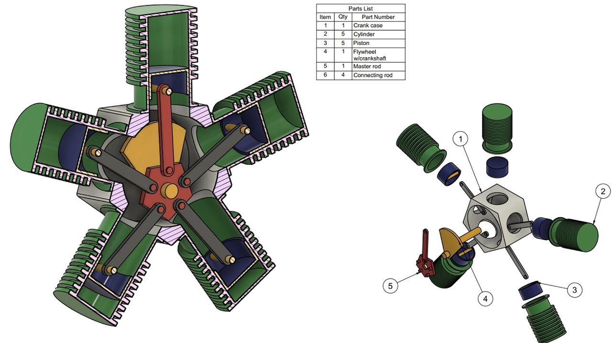
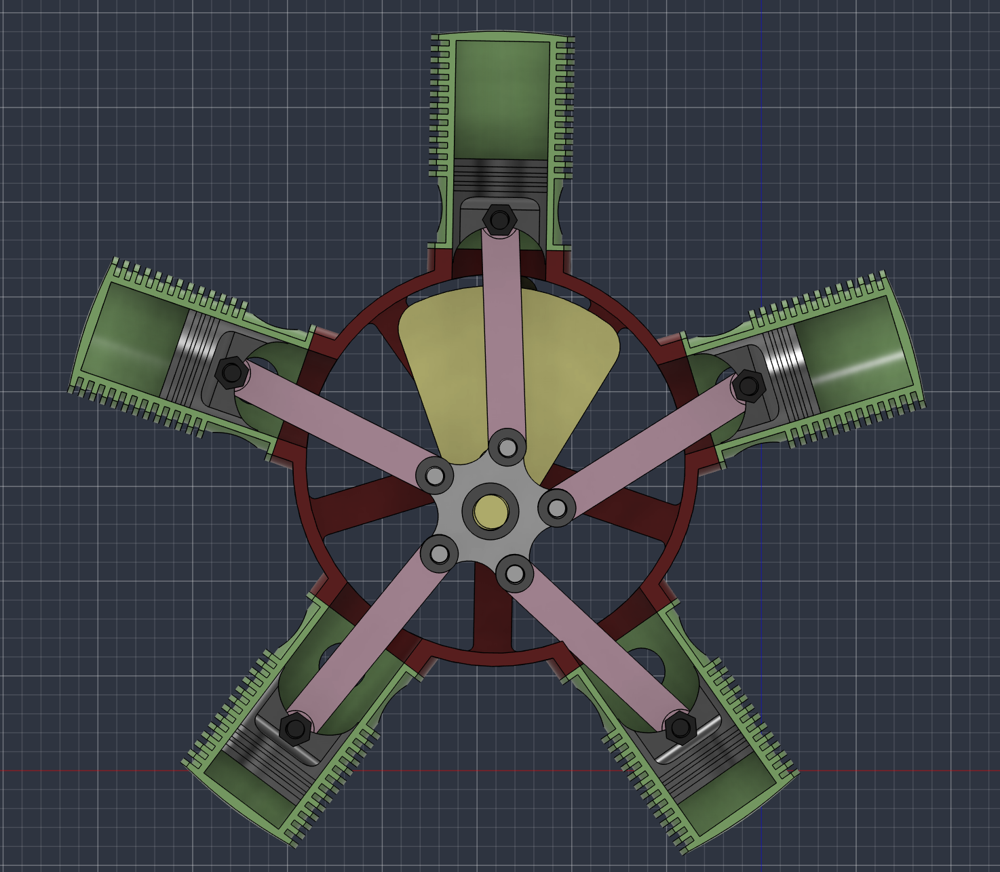
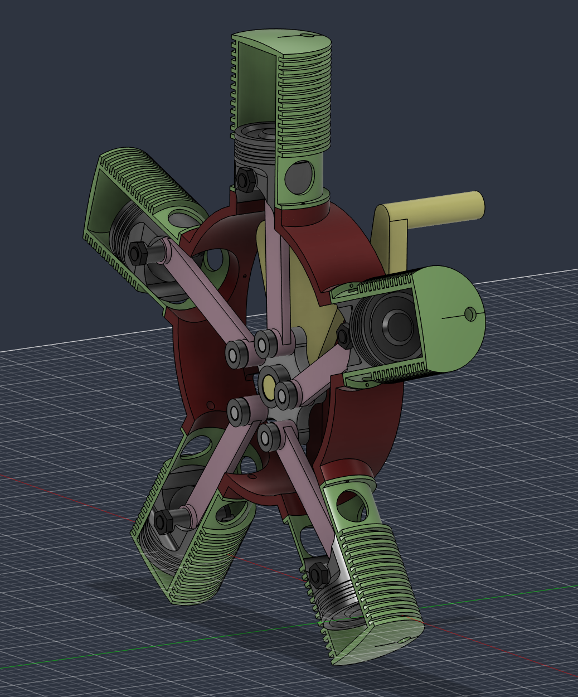
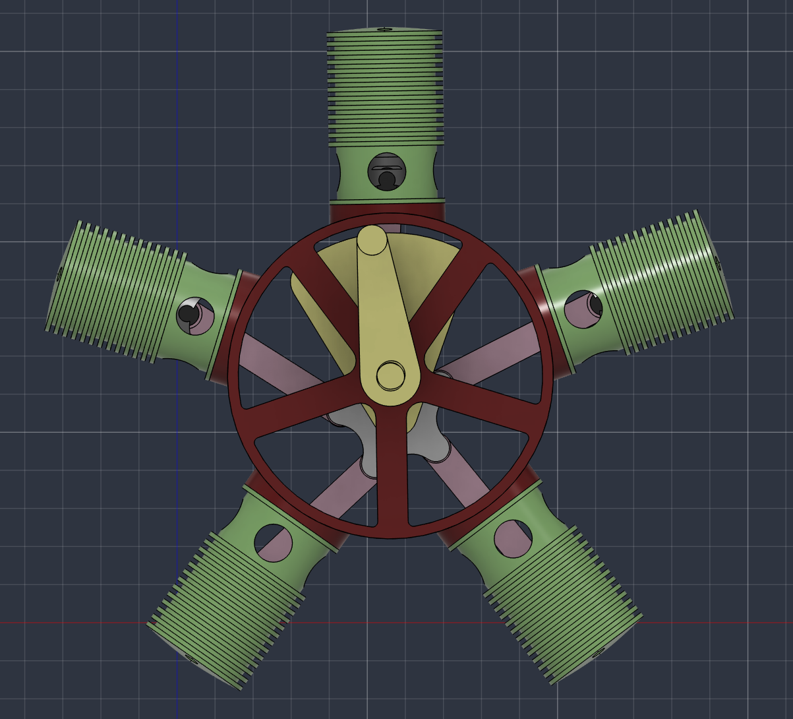

# radial-engine
For this project i made a 3d model of a 5 cylinder radial engine. My goal with this was to learn more about how real engines work (which i defenetly did) and sharpen my abilities with CAD and fusion 360. This model is not, nor is it suposed to be an acurate representation of an engin. Real engines are way more complex then what i did and i personally didnt have much time to work on this, so the goal of the model is to show the internal movement of the parts in an engine. I surely will have to update the files because i never get the dimentions right the first time but i have my own 3d printer so i dont think it will be that big of a problem. That said, i cant wait to print it and have that engine in front of me:)

### Example of inspiration:

Image from youtube video (https://www.youtube.com/watch?v=m3xAY4AH_Ho)

## How it works
As i said before, this model isnt an acurate representation of an engine. Real engines generate movement by consuming fuel, and this project obviously wont produce energy. However, i think the way the pistons and the other parts move is acceptable. To see everything in motion you just need to use the lever i put behid the main frame.

## Pictures
 
Front view:
 

 
Diagonal view:
 

 
Back view:
 

## Assembly
Assembling the engine is very stright forward, you basicly just have to copy the way everything is placed on the project file. However, i used a lot of self-printing screws and nuts which im not sure it was a good ideia yet... The only thing that doesnt show on the CAD file is how to assemble the chambers to the main frame. For doing so you need to have some real screws (they where too tiny to print) and screw it into the plastic.

## Bill of materials
Im very confident that ill have to print some parts more then once because of errors in the measurements. Because of that i dicided that i will print everything for myself. I have a 3d printer and it isnt that great but i think it will do for this project. Because of that i wont need any funding for this project.

## Important files

- `Untitled.f3d`: the project
- `images/`: pictures
